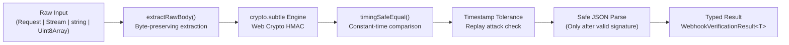

# webhook-kit

> **Zero-dependency, edge-compatible webhook signature verification toolkit powered by the Web Cryptography API (`crypto.subtle`).**

[](https://opensource.org/licenses/MIT)
[](#)
[](#supported-runtimes)

---

## The Problem: The JSON Re-serialization Pitfall

Developers building webhooks in modern frameworks (Next.js, Hono, Remix, Cloudflare Workers) constantly run into signature verification failures.

Why? Because parsing incoming requests as JSON strips original whitespace, normalizes numbers, and reorders object keys. When you try to re-stringify that JSON, **the resulting string does not match the sender's original payload bytes**, immediately breaking cryptographic HMAC verification:

```ts
// The pitfall: Parsing JSON changes bytes and invalidates HMAC
export async function POST(req: Request) {
  const json = await req.json(); // strips whitespace & reorders keys
  const isValid = verify(JSON.stringify(json), sig, secret); // Fails verification
}

// With webhook-kit: Direct Web Standard verification & constant-time check
import { verifyWebhookSignature } from "@amirabaris/webhook-kit";

export async function POST(req: Request) {
  const result = await verifyWebhookSignature({
    body: req, // Pass Web Standard Request directly
    signature: req.headers.get("x-signature")!,
    secret: process.env.WEBHOOK_SECRET!,
  });

  if (!result.valid) {
    return new Response("Unauthorized", { status: 401 });
  }

  // Safely use typed payload parsed AFTER valid signature verification
  const payload = result.payload;
  return Response.json({ received: true });
}
```

---

## Why `webhook-kit`?

- **Zero Dependencies**: 0 runtime dependencies for a tiny bundle footprint.
- **Universal Edge Support**: Built entirely on the Web Cryptography API (`crypto.subtle`) and Web Standards (`Request`, `Headers`, `Uint8Array`). Works on Node.js, Bun, Deno, Cloudflare Workers, Next.js Edge, and Fastly Compute.
- **Automatic Stream-Cloning**: Internally calls `req.clone().text()`, leaving the incoming body stream unconsumed (`req.bodyUsed === false`) so downstream middleware, proxies, and logging never throw `Body already consumed`.
- **Constant-Time Comparison**: Built-in timing-safe equality prevents timing side-channel attacks.
- **Replay Protection & Store**: Built-in timestamp tolerance verification plus pluggable memory / Redis / Cloudflare KV idempotency stores (`WebhookReplayStore`).
- **Universal 3-Line Route Handler**: `createWebhookHandler` drops directly into Next.js App Router and Hono with automatic error mapping (`401`, `400`, `409`) and typed dispatch.
- **Extensible Architecture**: Modular provider plugin system (Stripe, GitHub, Shopify, and custom providers).
- **Agent-First DX**: Includes specialized rules and CLI tools to ensure AI assistants (Cursor, Claude, Copilot) write safe webhook code.

---

## Supported Runtimes

| Runtime                   | Support     | Notes                                  |
| ------------------------- | ----------- | -------------------------------------- |
| **Node.js**               | `>= 22.0.0` | Uses native `globalThis.crypto.subtle` |
| **Bun**                   | `>= 1.0.0`  | Native Web Cryptography API            |
| **Deno**                  | `>= 1.30.0` | Native Web Standards                   |
| **Cloudflare Workers**    | Supported   | Zero Node polyfills needed             |
| **Next.js (Edge & Node)** | Supported   | Works with App Router `Request`        |
| **Fastly Compute**        | Supported   | Web Standards compliant                |

---

## Installation

```bash
# pnpm
pnpm add @amirabaris/webhook-kit

# npm
npm install @amirabaris/webhook-kit

# bun
bun add @amirabaris/webhook-kit

# yarn
yarn add @amirabaris/webhook-kit
```

---

## Quick Start

### 3-Line Route Handler (`createWebhookHandler`)

Drop `createWebhookHandler` directly into **Next.js App Router** (`Request`) or **Hono** (`Context`) routes. It automatically clones the raw request stream, verifies the cryptographic signature, and dispatches the strongly typed event payload:

```ts
// app/api/webhook/route.ts (Next.js App Router)
import { createWebhookHandler } from "@amirabaris/webhook-kit";

export const POST = createWebhookHandler({
  provider: "stripe",
  secret: process.env.STRIPE_WEBHOOK_SECRET!,
  onEvent: async (event) => {
    console.log("Verified Stripe event:", event.type, event.id);
  },
});
```

### Unified Verification (`verifyWebhookSignature` & `assertWebhookSignature`)

For custom control flow, `webhook-kit` also provides `verifyWebhookSignature` and `assertWebhookSignature` across providers and runtimes:

```ts
import {
  verifyWebhookSignature,
  assertWebhookSignature,
} from "@amirabaris/webhook-kit";

// 1. Result-based verification (discriminated union)
const result = await verifyWebhookSignature({
  body: req, // Pass Web Standard Request, Stream, Buffer, or string directly
  secret: process.env.STRIPE_WEBHOOK_SECRET!,
  provider: "stripe", // Built-in: 'stripe' | 'github' | 'shopify' (or generic HMAC)
  toleranceSeconds: 300, // Built-in replay attack protection
});

if (!result.valid) {
  // result.error is strongly typed WebhookKitError
  console.error("Verification failed:", result.error.message);
} else {
  // result.payload is automatically typed (e.g. StripeWebhookEvent)
  console.log("Verified payload:", result.payload);
}

// 2. Or assert mode (returns typed payload or throws typed WebhookKitError)
const payload = await assertWebhookSignature({
  body: req,
  secret: process.env.GITHUB_WEBHOOK_SECRET!,
  provider: "github",
});
```

---

## Framework Recipes & Automatic Stream-Cloning

In modern Web Standards runtimes (Next.js App Router, Hono, Cloudflare Workers), the incoming `Request` body is a single-use `ReadableStream`. In conventional implementations, consuming the stream via `await req.text()` drains it immediately (`req.bodyUsed === true`), which breaks downstream middleware, logging proxies, or subsequent `await req.json()` handlers with:

```text
TypeError: Body has already been consumed
```

`webhook-kit` solves this transparently with **automatic stream-cloning**:

- When you pass a `Request` to `verifyWebhookSignature` or `createWebhookHandler`, the library internally calls `request.clone().text()`.
- The original incoming `Request` remains pristine and unconsumed (`req.bodyUsed === false`).
- You can safely inspect typed payloads, access raw event bytes, forward the untouched `Request` to upstream services or queues, or invoke `await req.json()` downstream without stream errors.

### Next.js App Router (`app/api/webhook/route.ts`)

#### Option A: Declarative 3-Line Route Handler (`createWebhookHandler`)

Export `createWebhookHandler` directly as your Next.js `POST` route handler. It automatically unwraps the `Request`, clones the stream, verifies HMAC and replay timestamp tolerances, and dispatches the typed event:

```ts
// app/api/webhook/route.ts — 3-line declarative route handler
import { createWebhookHandler } from "@amirabaris/webhook-kit";

export const POST = createWebhookHandler({
  provider: "stripe",
  secret: process.env.STRIPE_WEBHOOK_SECRET!,
  onEvent: async (event, { rawBody, request }) => {
    // event is strongly typed StripeWebhookEvent
    // request.bodyUsed remains false thanks to automatic stream-cloning!
    switch (event.type) {
      case "checkout.session.completed":
        console.log("Fulfilling checkout session:", event.data.object.id);
        break;
      default:
        console.log(`Unhandled event type: ${event.type}`);
    }
  },
});
```

#### Option B: Manual Verification with Automatic Stream-Cloning (`verifyWebhookSignature`)

If your route requires custom branching, telemetry, or subsequent body access, pass `req` directly. Because `webhook-kit` clones the stream internally, `req.bodyUsed` remains `false`:

```ts
// app/api/webhook/route.ts
import { NextResponse } from "next/server";
import { verifyWebhookSignature } from "@amirabaris/webhook-kit";

export async function POST(req: Request) {
  // Pass Web Standard `Request` directly.
  // webhook-kit clones the stream via req.clone(), extracting exact raw bytes
  // without consuming the original request stream (req.bodyUsed stays false).
  const result = await verifyWebhookSignature({
    body: req,
    secret: process.env.STRIPE_WEBHOOK_SECRET!,
    provider: "stripe", // Automatically parses and verifies Stripe-Signature (v1 + timestamp)
    toleranceSeconds: 300,
  });

  if (!result.valid) {
    console.error("Stripe verification failed:", result.error.message);
    return new NextResponse(`Webhook Error: ${result.error.message}`, {
      status: 400,
    });
  }

  // Strongly typed payload parsed after valid HMAC verification
  const event = result.payload;
  console.log("Verified Stripe event:", event.type, event.id);

  // Automatic stream-cloning guarantee:
  // req.bodyUsed is STILL false! Downstream handlers, logging utilities,
  // or req.json() can still execute safely without throwing "Body already read":
  // const rawJson = await req.json();

  return NextResponse.json({ received: true, id: event.id });
}
```

### Hono (`src/index.ts`)

`webhook-kit` natively supports Hono routes in edge and serverless environments.

#### Option A: Declarative Route Handler (`createWebhookHandler`)

`createWebhookHandler` automatically unwraps Hono's `Context` (`c.req.raw`), resolves environment secrets dynamically via `c.env`, clones the stream, and dispatches verified events:

```ts
// src/index.ts
import { Hono } from "hono";
import { createWebhookHandler } from "@amirabaris/webhook-kit";

type Bindings = {
  GITHUB_WEBHOOK_SECRET: string;
};

const app = new Hono<{ Bindings: Bindings }>();

// Natively unwraps Hono Context, clones c.req.raw, and resolves dynamic secrets
app.post(
  "/api/webhook",
  createWebhookHandler({
    provider: "github",
    secret: (c) => c.env.GITHUB_WEBHOOK_SECRET,
    onEvent: async (event, { request }) => {
      // event is strongly typed GithubWebhookEvent
      // request.bodyUsed is false — Hono context is completely undisturbed
      console.log("Verified GitHub webhook action:", event.action);
    },
  }),
);

export default app;
```

#### Option B: Manual Verification with Automatic Stream-Cloning (`verifyWebhookSignature`)

Pass `c.req.raw` directly to `verifyWebhookSignature`. Because `c.req.raw` is cloned under the hood, subsequent Hono middleware or route logic can still call `await c.req.json()` or `await c.req.text()` without triggering a stream exhaustion error:

```ts
// src/index.ts
import { Hono } from "hono";
import { verifyWebhookSignature } from "@amirabaris/webhook-kit";

type Bindings = {
  GITHUB_WEBHOOK_SECRET: string;
};

const app = new Hono<{ Bindings: Bindings }>();

app.post("/api/webhook", async (c) => {
  // Pass c.req.raw directly — webhook-kit clones the stream internally:
  const result = await verifyWebhookSignature({
    body: c.req.raw,
    secret: c.env.GITHUB_WEBHOOK_SECRET,
    provider: "github",
  });

  if (!result.valid) {
    return c.text(`Unauthorized: ${result.error.message}`, 401);
  }

  // Safe: c.req.raw was not consumed: other Hono plugins or c.req.json() remain fully usable!
  const event = result.payload;
  return c.json({ received: true, action: event.action });
});

export default app;
```

### Cloudflare Workers (`src/worker.ts`)

Cloudflare Workers isolates enforce strict single-read constraints on incoming `ReadableStream` instances. `webhook-kit` runs with zero Node polyfills and uses standard `crypto.subtle`.

#### Automatic Stream-Cloning & Proxy Forwarding

When passing `request` to `verifyWebhookSignature`, `webhook-kit` invokes `request.clone().text()`. This keeps `request.bodyUsed === false`, allowing you to safely forward the pristine original `request` to an upstream backend, queue, or analytics pipeline:

```ts
// src/worker.ts
import { verifyWebhookSignature } from "@amirabaris/webhook-kit";

interface Env {
  STRIPE_WEBHOOK_SECRET: string;
  INTERNAL_API_URL: string;
}

export default {
  async fetch(
    request: Request,
    env: Env,
    ctx: ExecutionContext,
  ): Promise<Response> {
    if (
      request.method !== "POST" ||
      new URL(request.url).pathname !== "/api/webhook"
    ) {
      return new Response("Not Found", { status: 404 });
    }

    // Automatic Stream-Cloning:
    // Webhook-kit automatically clones request via request.clone().
    // Cryptographic HMAC verification succeeds WITHOUT locking or draining request.body!
    const result = await verifyWebhookSignature({
      body: request,
      secret: env.STRIPE_WEBHOOK_SECRET,
      provider: "stripe",
      toleranceSeconds: 300,
    });

    if (!result.valid) {
      return new Response(`Unauthorized: ${result.error.message}`, {
        status: 401,
      });
    }

    // Safe: request.bodyUsed is still false!
    // You can forward the original unconsumed request directly to your internal service:
    const upstreamResponse = await fetch(env.INTERNAL_API_URL, request);

    return new Response(upstreamResponse.body, {
      status: upstreamResponse.status,
      headers: upstreamResponse.headers,
    });
  },
};
```

### Express & Node.js HTTP Handler

In Express and Node.js HTTP servers, the most common pitfall is global JSON body parsers that mutate request streams before your webhook handler executes.

#### Express

Configure your webhook endpoint with `express.raw({ type: "application/json" })` **before** any application-wide `express.json()` middleware:

```ts
// server.ts
import express from "express";
import { verifyWebhookSignature } from "@amirabaris/webhook-kit";

const app = express();

// IMPORTANT: Webhook routes must receive raw payload bytes (Buffer)
// Register this handler BEFORE global express.json() middleware!
app.post(
  "/api/webhook",
  express.raw({ type: "application/json" }),
  async (req, res) => {
    // req.body is a raw Buffer (Uint8Array), preserving original bytes
    const result = await verifyWebhookSignature({
      body: req.body,
      headers: req.headers, // webhook-kit inspects headers for signature and timestamp
      secret: process.env.STRIPE_WEBHOOK_SECRET!,
      provider: "stripe",
    });

    if (!result.valid) {
      console.error("Verification failed:", result.error.message);
      return res.status(400).send(`Webhook Error: ${result.error.message}`);
    }

    // result.payload is safely parsed and typed
    const event = result.payload;
    console.log("Verified event:", event.type);

    return res.json({ received: true });
  },
);

// Global JSON middleware for standard API endpoints
app.use(express.json());

app.listen(3000, () => console.log("Server listening on port 3000"));
```

#### Vanilla Node.js HTTP (`node:http`)

```ts
// server.mjs
import http from "node:http";
import { verifyWebhookSignature } from "@amirabaris/webhook-kit";

const server = http.createServer(async (req, res) => {
  if (req.method === "POST" && req.url === "/api/webhook") {
    // Buffer raw incoming stream chunks to preserve exact byte sequence
    const chunks: Buffer[] = [];
    for await (const chunk of req) {
      chunks.push(typeof chunk === "string" ? Buffer.from(chunk) : chunk);
    }
    const rawBody = Buffer.concat(chunks);

    const result = await verifyWebhookSignature({
      body: rawBody,
      headers: req.headers,
      secret: process.env.WEBHOOK_SECRET!,
      provider: "shopify", // Automatically verifies X-Shopify-Hmac-Sha256
    });

    if (!result.valid) {
      res.writeHead(400, { "Content-Type": "text/plain" });
      return res.end(`Verification failed: ${result.error.message}`);
    }

    res.writeHead(200, { "Content-Type": "application/json" });
    return res.end(JSON.stringify({ received: true }));
  }

  res.writeHead(404).end();
});

server.listen(3000);
```

---

## Error Handling Best Practices

`webhook-kit` provides two error handling styles and a strongly typed error class hierarchy:

### 1. Functional Pattern (Discriminated Union)

`verifyWebhookSignature` returns a discriminated union `WebhookVerificationResult<T>`. Checking `result.valid` cleanly narrows the types with full TypeScript compiler safety:

```ts
const result = await verifyWebhookSignature({
  body: req,
  secret: process.env.WEBHOOK_SECRET!,
  provider: "stripe",
});

if (!result.valid) {
  // TypeScript narrows result to WebhookVerificationFailure
  // result.error is guaranteed to be a WebhookKitError
  console.error("Error Code:", result.error.code);
  console.error("Error Message:", result.error.message);
  return new Response("Unauthorized", { status: 401 });
}

// TypeScript narrows result to WebhookVerificationSuccess<StripeWebhookEvent>
// result.payload is guaranteed non-null and typed
const event = result.payload;
console.log("Processed event:", event.id);
```

### 2. Exception Pattern (`assertWebhookSignature`)

If your application prefers `try / catch` blocks or centralized error middleware, use `assertWebhookSignature` (or pass `{ throwOnError: true }`). It returns the typed payload directly on success and throws a `WebhookKitError` on failure:

```ts
import {
  assertWebhookSignature,
  SignatureVerificationError,
  TimestampToleranceError,
  InvalidSignatureHeaderError,
  PayloadExtractionError,
} from "@amirabaris/webhook-kit";

try {
  const event = await assertWebhookSignature({
    body: req,
    secret: process.env.STRIPE_WEBHOOK_SECRET!,
    provider: "stripe",
    toleranceSeconds: 300,
  });

  // Direct access to typed payload
  return Response.json({ received: true });
} catch (err) {
  if (err instanceof TimestampToleranceError) {
    // Webhook timestamp outside tolerance window: possible replay attack or clock drift
    console.warn(
      `Replay protection: event timestamp ${err.timestamp} exceeded tolerance of ${err.toleranceSeconds}s`,
    );
    return new Response("Webhook timestamp expired", { status: 400 });
  }

  if (err instanceof SignatureVerificationError) {
    // Signature mismatch: tampered payload or incorrect signing secret
    console.error("Signature verification failed:", err.message);
    return new Response("Invalid signature", { status: 401 });
  }

  if (err instanceof InvalidSignatureHeaderError) {
    // Missing or malformed header (e.g. missing sha256= prefix or missing stripe-signature)
    return new Response("Malformed signature header", { status: 400 });
  }

  if (err instanceof PayloadExtractionError) {
    // Request stream could not be read
    return new Response("Invalid request payload", { status: 400 });
  }

  return new Response("Internal Server Error", { status: 500 });
}
```

### Error Classes & Error Codes

All errors inherit from `WebhookKitError` and include machine-readable `code` properties:

| Error Class                   | `code`                          | Root Cause & Mitigation                                                                          |
| ----------------------------- | ------------------------------- | ------------------------------------------------------------------------------------------------ |
| `SignatureVerificationError`  | `SIGNATURE_VERIFICATION_FAILED` | HMAC digest mismatch, missing secret, or invalid format (e.g., non-hex, wrong length).           |
| `TimestampToleranceError`     | `TIMESTAMP_TOLERANCE_EXCEEDED`  | Payload timestamp is outside `toleranceSeconds` window, or is non-finite (`NaN`/`Infinity`).     |
| `ReplayAttackError`           | `WEBHOOK_REPLAY_DETECTED`       | Event ID already exists in `store`. Prevents duplicate webhook processing within the TTL window. |
| `InvalidSignatureHeaderError` | `INVALID_SIGNATURE_HEADER`      | Header is missing, empty, or lacks required prefix (`sha256=`, `t=...,v1=...`).                  |
| `PayloadExtractionError`      | `PAYLOAD_EXTRACTION_FAILED`     | Body is an unsupported format or input stream was prematurely closed.                            |
| `WebhookKitError`             | `WEBHOOK_KIT_ERROR`             | Base class for all webhook-kit errors.                                                           |

### Replay Attack Mitigation & Idempotency Store (`WebhookReplayStore`)

Replay attacks occur when an attacker (or a retry storm) replays a valid webhook request to your server to trigger duplicate side effects (such as fulfilling an order twice).

`webhook-kit` combines two layers of replay protection:

1. **Timestamp Tolerance**:
   - **Stripe**: Parses `t=...` from `Stripe-Signature` and validates against `toleranceSeconds` (default: 300s). Fractional timestamps are safely floored.
   - **Generic**: Automatically inspects `x-webhook-timestamp` (or explicit `timestamp` option) and validates against `toleranceSeconds`.
   - **Strict Numeric Hardening**: Both `timestamp` and `toleranceSeconds` must be positive, finite numbers. Non-finite values (`NaN`, `Infinity`, `-Infinity`) or negative numbers immediately reject with `TimestampToleranceError` to prevent tolerance check bypasses.
2. **Idempotency / Replay Store (`store: { has(eventId), set(eventId, ttl), setNx?(eventId, ttl) }`)**:
   - Pass any synchronous or asynchronous store implementing `WebhookReplayStore`.
   - Supports atomic `setNx` (_set-if-not-exists_) to eliminate race conditions under concurrent deliveries. If `setNx` is omitted, `webhook-kit` automatically serializes in-flight checks.
   - `webhook-kit` automatically extracts the event ID from `options.eventId`, standard delivery headers (`svix-id`, `webhook-id`, `X-GitHub-Delivery`, `X-Shopify-Webhook-Id`, `X-Webhook-Id`), or `payload.id` **after** cryptographic HMAC verification succeeds, and rejects duplicates with `ReplayAttackError` (`409 Conflict` in `createWebhookHandler`).
   - Supports both string and numeric event IDs (e.g. Shopify numeric webhook IDs) seamlessly.

#### Default In-Memory TTL Store (`createInMemoryReplayStore`)

For single-instance Node, Bun, or Deno servers, use the built-in zero-dependency TTL store with atomic `setNx`, automatic expiration, and LRU capacity bounding:

```ts
import {
  createWebhookHandler,
  createInMemoryReplayStore,
} from "@amirabaris/webhook-kit";

const replayStore = createInMemoryReplayStore({
  maxSize: 10_000,
  defaultTtlSeconds: 300,
});

export const POST = createWebhookHandler({
  provider: "stripe",
  secret: process.env.STRIPE_WEBHOOK_SECRET!,
  store: replayStore,
  onEvent: async (event, { eventId }) => {
    console.log("Processing unique event:", eventId, event.type);
  },
});
```

#### Distributed Store Hooks (Redis / Upstash / Cloudflare KV)

For multi-instance or serverless edge deployments, wire a lightweight `WebhookReplayStore` adapter into Redis, Upstash, or Cloudflare Workers KV. Provide `setNx` (e.g. Redis `SET key value EX ttl NX`) for hardware-level atomic de-duplication:

```ts
import type { WebhookReplayStore } from "@amirabaris/webhook-kit";

// 1. Node / Bun Redis (ioredis or node-redis) with atomic setNx
const redisStore: WebhookReplayStore = {
  has: async (id) => (await redis.exists(`wh:replay:${id}`)) === 1,
  set: async (id, ttl) => await redis.set(`wh:replay:${id}`, "1", "EX", ttl),
  // Optional atomic set-if-not-exists for distributed lock-free deduplication
  setNx: async (id, ttl) => {
    const res = await redis.set(`wh:replay:${id}`, "1", "EX", ttl, "NX");
    return res === "OK";
  },
};

// 2. Upstash Redis (@upstash/redis — Edge & Next.js) with atomic setNx
const upstashStore: WebhookReplayStore = {
  has: async (id) => (await upstash.exists(`wh:replay:${id}`)) === 1,
  set: async (id, ttl) =>
    await upstash.set(`wh:replay:${id}`, "1", { ex: ttl }),
  setNx: async (id, ttl) => {
    const res = await upstash.set(`wh:replay:${id}`, "1", {
      ex: ttl,
      nx: true,
    });
    return res !== null;
  },
};

// 3. Cloudflare Workers KV ( passed via Hono / Worker env )
const createCloudflareKvStore = (kv: KVNamespace): WebhookReplayStore => ({
  has: async (id) => (await kv.get(`wh:replay:${id}`)) !== null,
  set: async (id, ttl) =>
    await kv.put(`wh:replay:${id}`, "1", {
      expirationTtl: Math.max(60, ttl),
    }),
});
```

---

## Architecture Overview



`webhook-kit` is organized into modular layers:

- **`crypto/`**: Web Cryptography API (`crypto.subtle`) primitives, key LRU caching, and constant-time buffer comparison (`timingSafeEqual`).
- **`utils/`**: Stream and header utilities (`extractRawBody`, `extractHeaderValue`) preserving raw bytes without consuming input requests.
- **`providers/`**: Pluggable provider-specific format parsers and verifiers (Stripe timestamped `t=...,v1=...`, GitHub `sha256=...`, Shopify Base64).
- **`store/`**: Idempotency and replay attack prevention (`InMemoryReplayStore`, `checkAndRecordReplay`, atomic `setNx`).
- **`handler/`**: Declarative universal route handler (`createWebhookHandler`) for Next.js, Hono, and WinterCG runtimes.
- **`errors.ts`**: Strongly typed error class hierarchy (`SignatureVerificationError`, `TimestampToleranceError`, `ReplayAttackError`, `InvalidSignatureHeaderError`, `PayloadExtractionError`).

---

## Agent-First Developer Experience (DX)

`webhook-kit` provides first-class support for AI coding assistants (Claude Code, Cursor, Copilot, Gemini) to prevent them from accidentally generating broken JSON re-stringification patterns.

### Automatically Configure Your Project

Run the built-in zero-dependency CLI to inject webhook rules into your project's `AGENTS.md` or `CLAUDE.md`:

```bash
npx @amirabaris/webhook-kit init-agent
```

For full details, see the [Agent Rules Guide](file:///docs/agent-rules.md).

---

## Contributing & Commit Rules

We welcome contributions! Please read [`CONTRIBUTE.md`](file:///CONTRIBUTE.md) for full guidelines.

We strictly follow **Conventional Commits**:

```text
type(scope): brief description in imperative mood
```

Permitted types: `feat`, `fix`, `docs`, `test`, `refactor`, `chore`.

---

## License

[MIT](file:///LICENSE) © [Amir Abaris](https://github.com/AmirAbaris)
