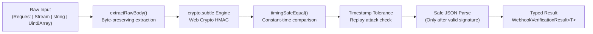

# webhook-kit

> **Zero-dependency, edge-compatible webhook signature verification toolkit powered by the Web Cryptography API (`crypto.subtle`).**

[](https://opensource.org/licenses/MIT)
[](#)
[](#supported-runtimes)

---

## The Problem: The JSON Re-serialization Pitfall

Developers building webhooks in modern frameworks (Next.js, Hono, Remix, Cloudflare Workers) constantly run into signature verification failures.

Why? Because parsing incoming requests as JSON strips original whitespace, normalizes numbers, and reorders object keys. When you try to re-stringify that JSON, **the resulting string does not match the sender's original payload bytes**, immediately breaking cryptographic HMAC verification:

```ts
// ❌ THE PITFALL: Parsing JSON changes bytes and invalidates HMAC
export async function POST(req: Request) {
  const json = await req.json(); // strips whitespace & reorders keys
  const isValid = verify(JSON.stringify(json), sig, secret); // 💥 ALWAYS FAILS
}

// ✅ WITH WEBHOOK-KIT: Direct Web Standard verification & constant-time check
import { verifyWebhookSignature } from "@amirabaris/webhook-kit";

export async function POST(req: Request) {
  const result = await verifyWebhookSignature({
    body: req, // Pass Web Standard Request directly!
    signature: req.headers.get("x-signature")!,
    secret: process.env.WEBHOOK_SECRET!,
  });

  if (!result.valid) {
    return new Response("Unauthorized", { status: 401 });
  }

  // Safely use typed payload parsed AFTER valid signature verification
  const payload = result.payload;
  return Response.json({ received: true });
}
```

---

## Why `webhook-kit`?

- 🪶 **Zero Dependencies**: 0 runtime dependencies for a tiny bundle footprint.
- ⚡ **Universal Edge Support**: Built entirely on the Web Cryptography API (`crypto.subtle`) and Web Standards (`Request`, `Headers`, `Uint8Array`). Works on Node.js, Bun, Deno, Cloudflare Workers, Next.js Edge, and Fastly Compute.
- ⏱️ **Constant-Time Comparison**: Built-in timing-safe equality prevents timing side-channel attacks.
- 🛡️ **Replay Protection**: Built-in timestamp tolerance verification.
- 🧩 **Extensible Architecture**: Modular provider plugin system (Stripe, GitHub, Shopify, and custom providers).
- 🤖 **Agent-First DX**: Includes specialized rules and CLI tools to ensure AI assistants (Cursor, Claude, Copilot) write safe webhook code.

---

## Supported Runtimes

| Runtime                   | Support     | Notes                                  |
| ------------------------- | ----------- | -------------------------------------- |
| **Node.js**               | `>= 22.0.0` | Uses native `globalThis.crypto.subtle` |
| **Bun**                   | `>= 1.0.0`  | Native Web Cryptography API            |
| **Deno**                  | `>= 1.30.0` | Native Web Standards                   |
| **Cloudflare Workers**    | Supported   | Zero Node polyfills needed             |
| **Next.js (Edge & Node)** | Supported   | Works with App Router `Request`        |
| **Fastly Compute**        | Supported   | Web Standards compliant                |

---

## Installation

```bash
# pnpm
pnpm add @amirabaris/webhook-kit

# npm
npm install @amirabaris/webhook-kit

# bun
bun add @amirabaris/webhook-kit

# yarn
yarn add @amirabaris/webhook-kit
```

---

## Quick Start

### 3-Line Route Handler (`createWebhookHandler`)

Drop `createWebhookHandler` directly into **Next.js App Router** (`Request`) or **Hono** (`Context`) routes. It automatically clones the raw request stream, verifies the cryptographic signature, and dispatches the strongly typed event payload:

```ts
// app/api/webhook/route.ts (Next.js App Router)
import { createWebhookHandler } from "@amirabaris/webhook-kit";

export const POST = createWebhookHandler({
  provider: "stripe",
  secret: process.env.STRIPE_WEBHOOK_SECRET!,
  onEvent: async (event) => {
    console.log("Verified Stripe event:", event.type, event.id);
  },
});
```

### Unified Verification (`verifyWebhookSignature` & `assertWebhookSignature`)

For custom control flow, `webhook-kit` also provides `verifyWebhookSignature` and `assertWebhookSignature` across providers and runtimes:

```ts
import {
  verifyWebhookSignature,
  assertWebhookSignature,
} from "@amirabaris/webhook-kit";

// 1. Result-based verification (discriminated union)
const result = await verifyWebhookSignature({
  body: req, // Pass Web Standard Request, Stream, Buffer, or string directly
  secret: process.env.STRIPE_WEBHOOK_SECRET!,
  provider: "stripe", // Built-in: 'stripe' | 'github' | 'shopify' (or generic HMAC)
  toleranceSeconds: 300, // Built-in replay attack protection
});

if (!result.valid) {
  // result.error is strongly typed WebhookKitError
  console.error("Verification failed:", result.error.message);
} else {
  // result.payload is automatically typed (e.g. StripeWebhookEvent)
  console.log("Verified payload:", result.payload);
}

// 2. Or assert mode (returns typed payload or throws typed WebhookKitError)
const payload = await assertWebhookSignature({
  body: req,
  secret: process.env.GITHUB_WEBHOOK_SECRET!,
  provider: "github",
});
```

---

## Framework Recipes

### Next.js App Router (`app/api/webhook/route.ts`)

Export `createWebhookHandler` directly as your `POST` route handler, or pass the Web Standard `Request` to `verifyWebhookSignature` without calling `await req.json()` first:

```ts
// app/api/webhook/route.ts — 3-line declarative route handler
import { createWebhookHandler } from "@amirabaris/webhook-kit";

export const POST = createWebhookHandler({
  provider: "stripe",
  secret: process.env.STRIPE_WEBHOOK_SECRET!,
  onEvent: async (event) => {
    switch (event.type) {
      case "checkout.session.completed":
        // Handle business logic safely with typed StripeWebhookEvent
        break;
      default:
        console.log(`Unhandled event type: ${event.type}`);
    }
  },
});
```

Or using `verifyWebhookSignature` directly:

```ts
// app/api/webhook/route.ts
import { NextResponse } from "next/server";
import { verifyWebhookSignature } from "@amirabaris/webhook-kit";

export async function POST(req: Request) {
  // CRITICAL: Pass the Web Standard `Request` object directly to `body`.
  // Do NOT call `await req.json()` beforehand! Parsing JSON alters raw payload bytes and breaks HMAC.
  // webhook-kit extracts raw bytes with req.clone() and automatically reads signature headers.
  const result = await verifyWebhookSignature({
    body: req,
    secret: process.env.STRIPE_WEBHOOK_SECRET!,
    provider: "stripe", // Automatically parses and verifies Stripe-Signature (v1 + timestamp)
  });

  if (!result.valid) {
    console.error("Stripe verification failed:", result.error.message);
    return new NextResponse(`Webhook Error: ${result.error.message}`, {
      status: 400,
    });
  }

  // result.payload is typed StripeWebhookEvent
  const event = result.payload;
  console.log("Received Stripe event:", event.type, event.id);

  return NextResponse.json({ received: true });
}
```

### Cloudflare Workers / Hono (`src/index.ts`)

`webhook-kit` has zero runtime dependencies and uses standard `crypto.subtle`, making it run natively on Cloudflare Workers and Hono without Node.js compatibility flags or polyfills.

#### Hono

`createWebhookHandler` natively unwraps Hono's `Context` (`c.req.raw`) and supports dynamic secret resolution from `c.env`:

```ts
// src/index.ts
import { Hono } from "hono";
import { createWebhookHandler } from "@amirabaris/webhook-kit";

type Bindings = {
  GITHUB_WEBHOOK_SECRET: string;
};

const app = new Hono<{ Bindings: Bindings }>();

app.post(
  "/api/webhook",
  createWebhookHandler({
    provider: "github",
    secret: (c) => c.env.GITHUB_WEBHOOK_SECRET,
    onEvent: async (event) => {
      // event is strongly typed GithubWebhookEvent
      console.log("GitHub event:", event.action);
    },
  }),
);

export default app;
```

#### Cloudflare Workers (Native `fetch`)

```ts
import { verifyWebhookSignature } from "@amirabaris/webhook-kit";

interface Env {
  STRIPE_WEBHOOK_SECRET: string;
}

export default {
  async fetch(request: Request, env: Env): Promise<Response> {
    if (
      request.method !== "POST" ||
      new URL(request.url).pathname !== "/api/webhook"
    ) {
      return new Response("Not Found", { status: 404 });
    }

    const result = await verifyWebhookSignature({
      body: request,
      secret: env.STRIPE_WEBHOOK_SECRET,
      provider: "stripe",
    });

    if (!result.valid) {
      return new Response(`Unauthorized: ${result.error.message}`, {
        status: 401,
      });
    }

    return Response.json({ received: true });
  },
};
```

### Express & Node.js HTTP Handler

In Express and Node.js HTTP servers, the most common pitfall is global JSON body parsers that mutate request streams before your webhook handler executes.

#### Express

Configure your webhook endpoint with `express.raw({ type: "application/json" })` **before** any application-wide `express.json()` middleware:

```ts
// server.ts
import express from "express";
import { verifyWebhookSignature } from "@amirabaris/webhook-kit";

const app = express();

// IMPORTANT: Webhook routes must receive raw payload bytes (Buffer)
// Register this handler BEFORE global express.json() middleware!
app.post(
  "/api/webhook",
  express.raw({ type: "application/json" }),
  async (req, res) => {
    // req.body is a raw Buffer (Uint8Array), preserving original bytes
    const result = await verifyWebhookSignature({
      body: req.body,
      headers: req.headers, // webhook-kit inspects headers for signature and timestamp
      secret: process.env.STRIPE_WEBHOOK_SECRET!,
      provider: "stripe",
    });

    if (!result.valid) {
      console.error("Verification failed:", result.error.message);
      return res.status(400).send(`Webhook Error: ${result.error.message}`);
    }

    // result.payload is safely parsed and typed
    const event = result.payload;
    console.log("Verified event:", event.type);

    return res.json({ received: true });
  },
);

// Global JSON middleware for standard API endpoints
app.use(express.json());

app.listen(3000, () => console.log("Server listening on port 3000"));
```

#### Vanilla Node.js HTTP (`node:http`)

```ts
// server.mjs
import http from "node:http";
import { verifyWebhookSignature } from "@amirabaris/webhook-kit";

const server = http.createServer(async (req, res) => {
  if (req.method === "POST" && req.url === "/api/webhook") {
    // Buffer raw incoming stream chunks to preserve exact byte sequence
    const chunks: Buffer[] = [];
    for await (const chunk of req) {
      chunks.push(typeof chunk === "string" ? Buffer.from(chunk) : chunk);
    }
    const rawBody = Buffer.concat(chunks);

    const result = await verifyWebhookSignature({
      body: rawBody,
      headers: req.headers,
      secret: process.env.WEBHOOK_SECRET!,
      provider: "shopify", // Automatically verifies X-Shopify-Hmac-Sha256
    });

    if (!result.valid) {
      res.writeHead(400, { "Content-Type": "text/plain" });
      return res.end(`Verification failed: ${result.error.message}`);
    }

    res.writeHead(200, { "Content-Type": "application/json" });
    return res.end(JSON.stringify({ received: true }));
  }

  res.writeHead(404).end();
});

server.listen(3000);
```

---

## Error Handling Best Practices

`webhook-kit` provides two error handling styles and a strongly typed error class hierarchy:

### 1. Functional Pattern (Discriminated Union)

`verifyWebhookSignature` returns a discriminated union `WebhookVerificationResult<T>`. Checking `result.valid` cleanly narrows the types with full TypeScript compiler safety:

```ts
const result = await verifyWebhookSignature({
  body: req,
  secret: process.env.WEBHOOK_SECRET!,
  provider: "stripe",
});

if (!result.valid) {
  // TypeScript narrows result to WebhookVerificationFailure
  // result.error is guaranteed to be a WebhookKitError
  console.error("Error Code:", result.error.code);
  console.error("Error Message:", result.error.message);
  return new Response("Unauthorized", { status: 401 });
}

// TypeScript narrows result to WebhookVerificationSuccess<StripeWebhookEvent>
// result.payload is guaranteed non-null and typed
const event = result.payload;
console.log("Processed event:", event.id);
```

### 2. Exception Pattern (`assertWebhookSignature`)

If your application prefers `try / catch` blocks or centralized error middleware, use `assertWebhookSignature` (or pass `{ throwOnError: true }`). It returns the typed payload directly on success and throws a `WebhookKitError` on failure:

```ts
import {
  assertWebhookSignature,
  SignatureVerificationError,
  TimestampToleranceError,
  InvalidSignatureHeaderError,
  PayloadExtractionError,
} from "@amirabaris/webhook-kit";

try {
  const event = await assertWebhookSignature({
    body: req,
    secret: process.env.STRIPE_WEBHOOK_SECRET!,
    provider: "stripe",
    toleranceSeconds: 300,
  });

  // Direct access to typed payload
  return Response.json({ received: true });
} catch (err) {
  if (err instanceof TimestampToleranceError) {
    // Webhook timestamp outside tolerance window: possible replay attack or clock drift
    console.warn(
      `Replay protection: event timestamp ${err.timestamp} exceeded tolerance of ${err.toleranceSeconds}s`,
    );
    return new Response("Webhook timestamp expired", { status: 400 });
  }

  if (err instanceof SignatureVerificationError) {
    // Signature mismatch: tampered payload or incorrect signing secret
    console.error("Signature verification failed:", err.message);
    return new Response("Invalid signature", { status: 401 });
  }

  if (err instanceof InvalidSignatureHeaderError) {
    // Missing or malformed header (e.g. missing sha256= prefix or missing stripe-signature)
    return new Response("Malformed signature header", { status: 400 });
  }

  if (err instanceof PayloadExtractionError) {
    // Request stream could not be read
    return new Response("Invalid request payload", { status: 400 });
  }

  return new Response("Internal Server Error", { status: 500 });
}
```

### Error Classes & Error Codes

All errors inherit from `WebhookKitError` and include machine-readable `code` properties:

| Error Class                   | `code`                          | Root Cause & Mitigation                                                                            |
| ----------------------------- | ------------------------------- | -------------------------------------------------------------------------------------------------- |
| `SignatureVerificationError`  | `SIGNATURE_VERIFICATION_FAILED` | HMAC digest mismatch or missing signing secret. Check that your webhook signing secret is correct. |
| `TimestampToleranceError`     | `TIMESTAMP_TOLERANCE_EXCEEDED`  | Payload timestamp exceeds `toleranceSeconds` window. Protects against replay attacks.              |
| `ReplayAttackError`           | `WEBHOOK_REPLAY_DETECTED`       | Event ID already exists in `store`. Prevents duplicate webhook processing within the TTL window.   |
| `InvalidSignatureHeaderError` | `INVALID_SIGNATURE_HEADER`      | Header is missing, empty, or lacks required prefix (`sha256=`, `t=...,v1=...`).                    |
| `PayloadExtractionError`      | `PAYLOAD_EXTRACTION_FAILED`     | Body is an unsupported format or input stream was prematurely closed.                              |
| `WebhookKitError`             | `WEBHOOK_KIT_ERROR`             | Base class for all webhook-kit errors.                                                             |

### Replay Attack Mitigation & Idempotency Store (`WebhookReplayStore`)

Replay attacks occur when an attacker (or a retry storm) replays a valid webhook request to your server to trigger duplicate side effects (such as fulfilling an order twice).

`webhook-kit` combines two layers of replay protection:

1. **Timestamp Tolerance**:
   - **Stripe**: Parses `t=...` from `Stripe-Signature` and validates against `toleranceSeconds` (default: 300s).
   - **Generic**: Automatically inspects `x-webhook-timestamp` (or explicit `timestamp` option) and validates against `toleranceSeconds`.
2. **Idempotency / Replay Store (`store: { has(eventId), set(eventId, ttl) }`)**:
   - Pass any synchronous or asynchronous store implementing `WebhookReplayStore` (`has(eventId)` and `set(eventId, ttlSeconds)`).
   - `webhook-kit` automatically extracts the event ID from `options.eventId`, standard delivery headers (`X-GitHub-Delivery`, `X-Shopify-Webhook-Id`, `X-Webhook-Id`), or `payload.id` **after** cryptographic HMAC verification succeeds, and rejects duplicates with `ReplayAttackError` (`409 Conflict` in `createWebhookHandler`).

#### Default In-Memory TTL Store (`createInMemoryReplayStore`)

For single-instance Node, Bun, or Deno servers, use the built-in zero-dependency TTL store with automatic expiration and LRU capacity bounding:

```ts
import {
  createWebhookHandler,
  createInMemoryReplayStore,
} from "@amirabaris/webhook-kit";

const replayStore = createInMemoryReplayStore({
  maxSize: 10_000,
  defaultTtlSeconds: 300,
});

export const POST = createWebhookHandler({
  provider: "stripe",
  secret: process.env.STRIPE_WEBHOOK_SECRET!,
  store: replayStore,
  onEvent: async (event, { eventId }) => {
    console.log("Processing unique event:", eventId, event.type);
  },
});
```

#### Distributed Store Hooks (Redis / Upstash / Cloudflare KV)

For multi-instance or serverless edge deployments, wire a 6-line `WebhookReplayStore` adapter into Redis, Upstash, or Cloudflare Workers KV:

```ts
import type { WebhookReplayStore } from "@amirabaris/webhook-kit";

// 1. Node / Bun Redis (ioredis or node-redis)
const redisStore: WebhookReplayStore = {
  has: async (id) => (await redis.exists(`wh:replay:${id}`)) === 1,
  set: async (id, ttl) => await redis.set(`wh:replay:${id}`, "1", "EX", ttl),
};

// 2. Upstash Redis (@upstash/redis — Edge & Next.js)
const upstashStore: WebhookReplayStore = {
  has: async (id) => (await upstash.exists(`wh:replay:${id}`)) === 1,
  set: async (id, ttl) =>
    await upstash.set(`wh:replay:${id}`, "1", { ex: ttl }),
};

// 3. Cloudflare Workers KV ( passed via Hono / Worker env )
const createCloudflareKvStore = (kv: KVNamespace): WebhookReplayStore => ({
  has: async (id) => (await kv.get(`wh:replay:${id}`)) !== null,
  set: async (id, ttl) =>
    await kv.put(`wh:replay:${id}`, "1", {
      expirationTtl: Math.max(60, ttl),
    }),
});
```

---

## Architecture Overview



`webhook-kit` is organized into modular layers:

- **`crypto/`**: Web Cryptography API (`crypto.subtle`) primitives and constant-time buffer comparison.
- **`utils/`**: Stream and body extraction that preserves raw payload bytes without consuming or mutating input requests.
- **`providers/`**: Pluggable provider-specific format parsers (Stripe timestamped `t=...,v1=...`, GitHub `sha256=...`, Shopify Base64, etc.).
- **`errors/`**: Strongly typed error classes (`SignatureVerificationError`, `TimestampToleranceError`, `PayloadExtractionError`).

---

## Agent-First Developer Experience (DX)

`webhook-kit` provides first-class support for AI coding assistants (Claude Code, Cursor, Copilot, Gemini) to prevent them from accidentally generating broken JSON re-stringification patterns.

### Automatically Configure Your Project

Run the built-in zero-dependency CLI to inject webhook rules into your project's `AGENTS.md` or `CLAUDE.md`:

```bash
npx @amirabaris/webhook-kit init-agent
```

For full details, see the [Agent Rules Guide](file:///docs/agent-rules.md).

---

## Contributing & Commit Rules

We welcome contributions! Please read [`CONTRIBUTE.md`](file:///CONTRIBUTE.md) for full guidelines.

We strictly follow **Conventional Commits**:

```text
type(scope): brief description in imperative mood
```

Permitted types: `feat`, `fix`, `docs`, `test`, `refactor`, `chore`.

---

## License

[MIT](file:///LICENSE) © [Amir Abaris](https://github.com/AmirAbaris)
