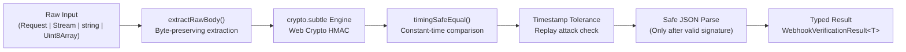

# webhook-kit

> **Zero-dependency, edge-compatible webhook signature verification toolkit powered by the Web Cryptography API (`crypto.subtle`).**

[](https://opensource.org/licenses/MIT)
[](#)
[](#supported-runtimes)

---

## The Problem: The JSON Re-serialization Pitfall

Developers building webhooks in modern frameworks (Next.js, Hono, Remix, Cloudflare Workers) constantly run into signature verification failures.

Why? Because parsing incoming requests as JSON strips original whitespace, normalizes numbers, and reorders object keys. When you try to re-stringify that JSON, **the resulting string does not match the sender's original payload bytes**, immediately breaking cryptographic HMAC verification:

```ts
// ❌ THE PITFALL: Parsing JSON changes bytes and invalidates HMAC
export async function POST(req: Request) {
  const json = await req.json(); // strips whitespace & reorders keys
  const isValid = verify(JSON.stringify(json), sig, secret); // 💥 ALWAYS FAILS
}

// ✅ WITH WEBHOOK-KIT: Direct Web Standard verification & constant-time check
import { verifyWebhookSignature } from "webhook-kit";

export async function POST(req: Request) {
  const result = await verifyWebhookSignature({
    body: req, // Pass Web Standard Request directly!
    signature: req.headers.get("x-signature")!,
    secret: process.env.WEBHOOK_SECRET!,
  });

  if (!result.valid) {
    return new Response("Unauthorized", { status: 401 });
  }

  // Safely use typed payload parsed AFTER valid signature verification
  const payload = result.payload;
  return Response.json({ received: true });
}
```

---

## Why `webhook-kit`?

- 🪶 **Zero Dependencies**: 0 runtime dependencies for a tiny bundle footprint.
- ⚡ **Universal Edge Support**: Built entirely on the Web Cryptography API (`crypto.subtle`) and Web Standards (`Request`, `Headers`, `Uint8Array`). Works on Node.js, Bun, Deno, Cloudflare Workers, Next.js Edge, and Fastly Compute.
- ⏱️ **Constant-Time Comparison**: Built-in timing-safe equality prevents timing side-channel attacks.
- 🛡️ **Replay Protection**: Built-in timestamp tolerance verification.
- 🧩 **Extensible Architecture**: Modular provider plugin system (Stripe, GitHub, Shopify, and custom providers).
- 🤖 **Agent-First DX**: Includes specialized rules and CLI tools to ensure AI assistants (Cursor, Claude, Copilot) write safe webhook code.

---

## Supported Runtimes

| Runtime                   | Support     | Notes                                  |
| ------------------------- | ----------- | -------------------------------------- |
| **Node.js**               | `>= 18.0.0` | Uses native `globalThis.crypto.subtle` |
| **Bun**                   | `>= 1.0.0`  | Native Web Cryptography API            |
| **Deno**                  | `>= 1.30.0` | Native Web Standards                   |
| **Cloudflare Workers**    | Supported   | Zero Node polyfills needed             |
| **Next.js (Edge & Node)** | Supported   | Works with App Router `Request`        |
| **Fastly Compute**        | Supported   | Web Standards compliant                |

---

## Installation

```bash
# pnpm
pnpm add webhook-kit

# npm
npm install webhook-kit

# bun
bun add webhook-kit

# yarn
yarn add webhook-kit
```

---

## Quick Start

### Generic Webhook Verification

```ts
import { verifyWebhookSignature, assertWebhookSignature } from "webhook-kit";

// 1. Boolean check with detailed result object
const result = await verifyWebhookSignature({
  body: rawPayloadOrRequest,
  signature: headerSignature,
  secret: process.env.SIGNING_SECRET!,
  algorithm: "SHA-256",
  toleranceSeconds: 300, // Replay attack protection
});

if (!result.valid) {
  console.error("Verification failed:", result.error?.message);
} else {
  console.log("Verified payload:", result.payload);
}

// 2. Or assert mode (throws on failure, returns typed payload)
const payload = await assertWebhookSignature<MyEventPayload>({
  body: rawPayloadOrRequest,
  signature: headerSignature,
  secret: process.env.SIGNING_SECRET!,
});
```

---

## Architecture Overview



`webhook-kit` is organized into modular layers:

- **`crypto/`**: Web Cryptography API (`crypto.subtle`) primitives and constant-time buffer comparison.
- **`utils/`**: Stream and body extraction that preserves raw payload bytes without consuming or mutating input requests.
- **`providers/`**: Pluggable provider-specific format parsers (Stripe timestamped `t=...,v1=...`, GitHub `sha256=...`, Shopify Base64, etc.).
- **`errors/`**: Strongly typed error classes (`SignatureVerificationError`, `TimestampToleranceError`, `PayloadExtractionError`).

---

## Agent-First Developer Experience (DX)

`webhook-kit` provides first-class support for AI coding assistants (Claude Code, Cursor, Copilot, Gemini) to prevent them from accidentally generating broken JSON re-stringification patterns.

### Automatically Configure Your Project

Run the built-in zero-dependency CLI to inject webhook rules into your project's `AGENTS.md` or `CLAUDE.md`:

```bash
npx webhook-kit init-agent
```

For full details, see the [Agent Rules Guide](file:///docs/agent-rules.md).

---

## Contributing & Commit Rules

We welcome contributions! Please read [`CONTRIBUTE.md`](file:///CONTRIBUTE.md) for full guidelines.

We strictly follow **Conventional Commits**:

```text
type(scope): brief description in imperative mood
```

Permitted types: `feat`, `fix`, `docs`, `test`, `refactor`, `chore`.

---

## License

[MIT](file:///LICENSE) © [Amir Abaris](https://github.com/AmirAbaris)
